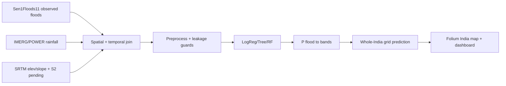

# Methodology

## REAL-DATA MODE (primary, default)
Sen1Floods11 binary labels (2 events, 6 chips) → event-locked rainfall
(IMERG primary via GEE; POWER executed) + SRTM elevation/slope → chip-spatial
split → balanced LogReg/Tree/Forest → P(flood) → pre-declared 0.33/0.66 bands →
**whole-India 0.1° GADM-masked grid** (same 5 features) → LOW/MEDIUM/HIGH map.
Guards: `assert_no_leakage`, no qcut, no future data, PR-AUC selection.
Land use via NDBI/NDVI path (no fake columns); drainage via terrain proxies.

## DEMO MODE (fallback)
Rule score → qcut thirds; stratified split; macro-F1. Labelled simulated only.

## Diagrams

